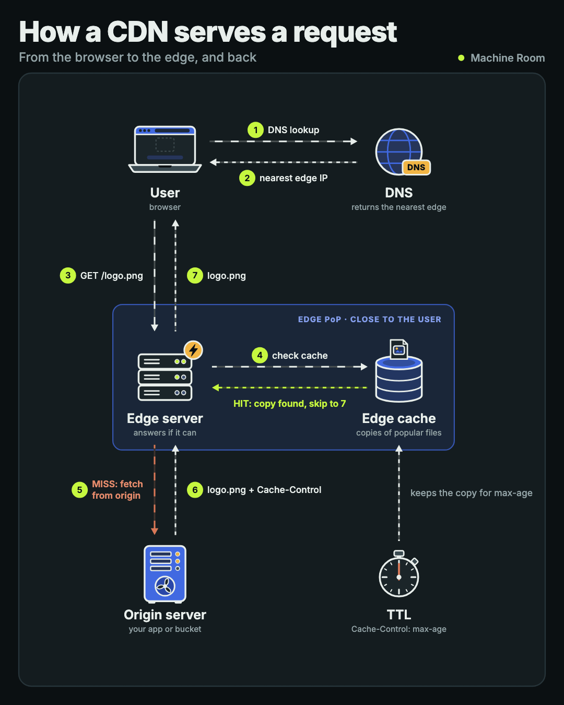
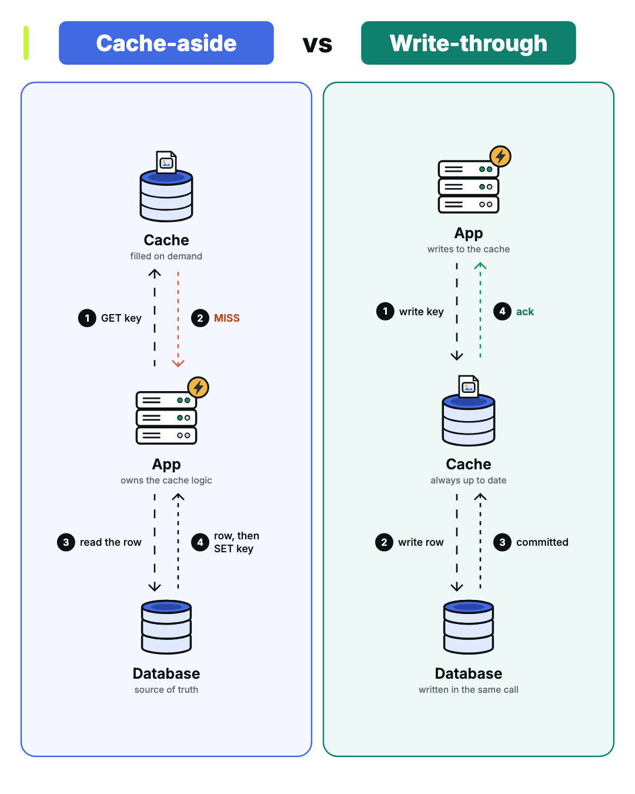
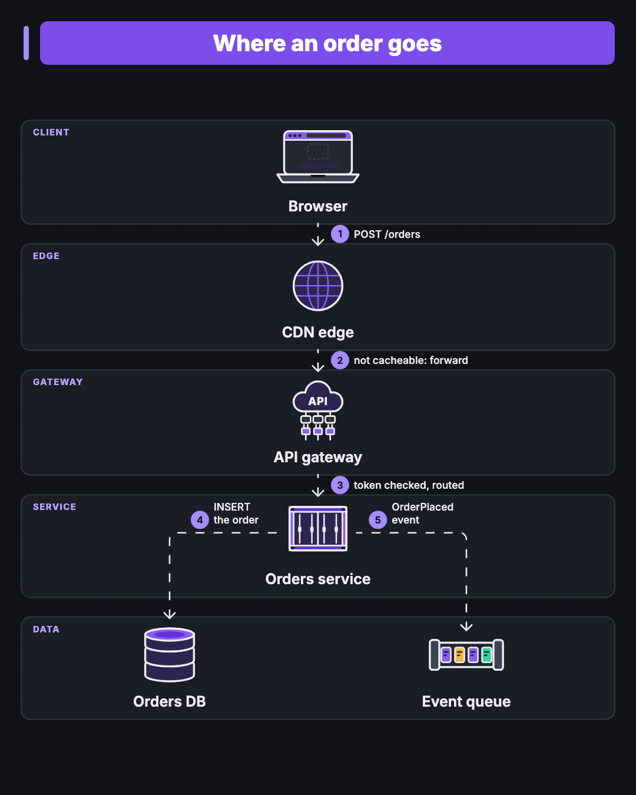

# animated-diagram


A Claude Code skill that turns a system-design topic into a looping animated diagram. You describe the topic, Claude
draws it, and you get a GIF, an MP4 and a still PNG. The arrows march in the direction of flow and every icon has its
own idle animation.

That diagram is the skill's own output, from [one JSON file](skills/animated-diagram/examples/anatomy-of-an-ai-app.json).

## Install

You need Node 22 or newer, Google Chrome and ffmpeg.

```sh
npx skills add machineroom-dev/animated-diagram -g -a claude-code -y
npm install --prefix ~/.claude/skills/animated-diagram
```

Or by hand:

```sh
git clone https://github.com/machineroom-dev/animated-diagram.git
cp -r animated-diagram/skills/animated-diagram ~/.claude/skills/
npm install --prefix ~/.claude/skills/animated-diagram
```

## Use

Ask Claude Code for one:

> Make an animated diagram of how a CDN serves a request.

Claude asks for a theme once per project, shows you the numbered steps to confirm, then renders. Every arrow is a
claim, so check the steps before it draws them.

Each render writes four files and takes a few seconds:

| File | What it is |
|---|---|
| `<name>.gif` | A seamless 2.7 s loop, usually under 1 MB at 1080×1350; about 1 MB for a dense map too |
| `<name>.mp4` | The same loop four times, 10.8 s |
| `<name>.png` | One still frame |
| `<name>.check.json` | The layout check: collisions, text off the card, tangled arrows, a jump at the loop point |

If the check fails you get no GIF. Claude reads the failures, moves things and renders again.

## Four layouts

A map is the one at the top: a whole system on one page, with colour zones, routed arrows and the steps in a legend. The
other three tell one story at feed size.

| Flow | Comparison | Stack |
|---|---|---|
|  |  |  |
| Numbered steps between nodes, with zones and hit or miss branches | Two approaches side by side | Layers from client to data |

## Themes

Set a theme once and every diagram follows it.

```sh
cli.mjs theme --preset machine-room-dark        # or light, dark
cli.mjs theme --brand "#E4572E,#17BEBB" --mode light
cli.mjs theme --from-image logo.png --mode dark
```

A theme whose text fails 4.5:1 contrast is refused, and you're offered the nearest colour that passes.

## Without Claude

The renderer is an ordinary command. You write a small JSON file with nodes in grid cells and numbered steps, and it
handles the coordinates. The format is in
[`reference/diagram-format.md`](skills/animated-diagram/reference/diagram-format.md), and there are four starting points in
[`examples/`](skills/animated-diagram/examples).

```sh
node ~/.claude/skills/animated-diagram/scripts/cli.mjs render my-diagram.json --theme light --out out/
```

`CHROME_PATH` points it at a Chrome binary other than the system one.

## Where to post

LinkedIn and X take the GIF. Instagram doesn't take GIFs, so use the MP4 or the PNG there.

## Develop

```sh
npm install --prefix skills/animated-diagram
npm test
```

Tested on macOS and Linux.

## License

MIT. The bundled Inter font is under the SIL Open Font License (`skills/animated-diagram/fonts/OFL.txt`).

Made by [Machine Room](https://themachineroom.dev), explainers on how software works. [Get the next free skill by email](https://themachineroom.dev/skills/animated-diagram/?utm_source=github&utm_medium=readme&utm_campaign=animated-diagram).
